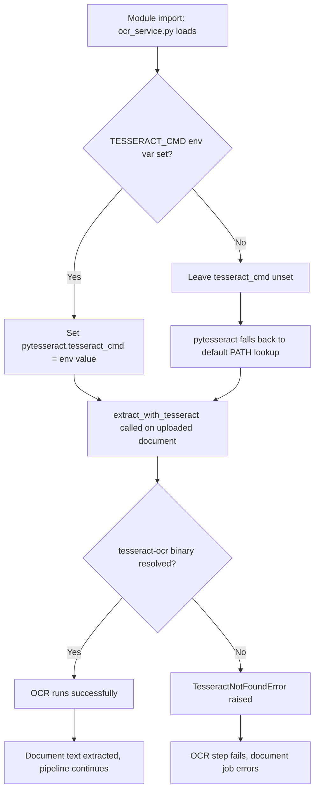
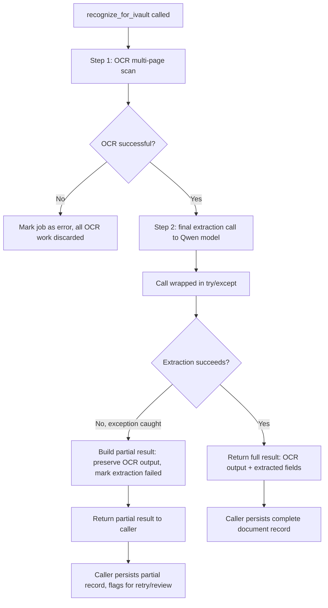
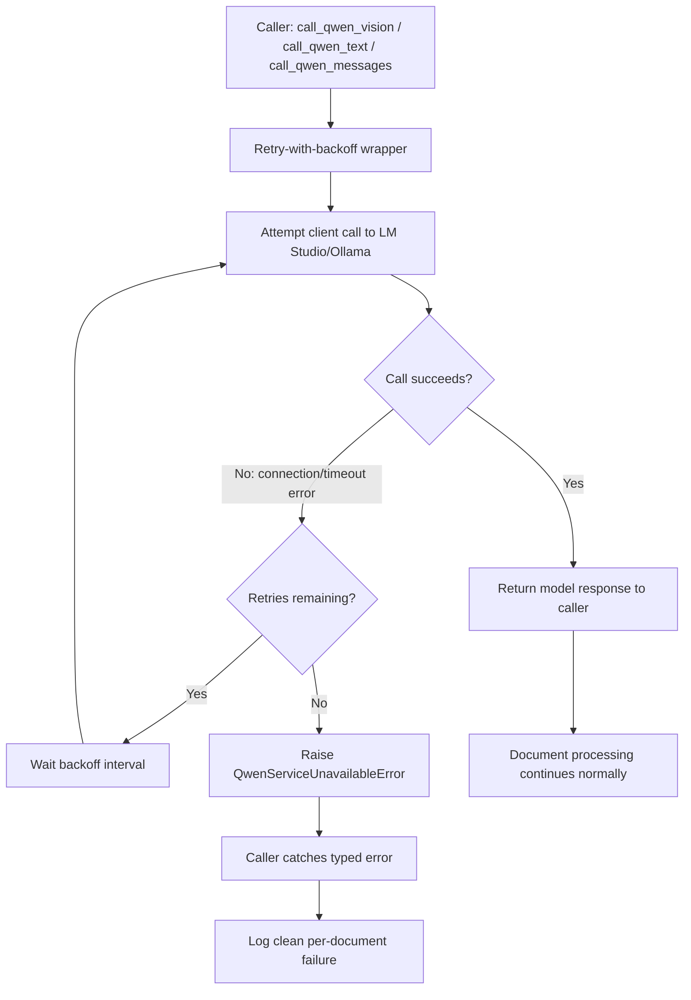

# Daily Tasks — 2026-08-17

Source: iProfiler Backlog (Notion) — 3 tasks moved to **In Progress** today.
Priority milestone in effect: security-hardening items remain deprioritized (Low) while the project is in prototype stage; this batch focuses on core OCR reliability and model-integration stability.

**Status update (2026-08-17, end of day):** All 7 tasks below are ✅ **Done** — verified in code and closed out in Notion with System Benefit notes and Completed Date stamps. For the next batch of open High-priority work, see [`.tasks/2026-08-17-remaining-high-priority.md`](./2026-08-17-remaining-high-priority.md).

---

## Task 1: Hardcoded Windows tesseract path breaks Linux/Docker OCR — ✅ DONE

**Notion Reference:** High priority — https://app.notion.com/3bcb8d467eca81318576f789c9099c72

**Target File:** `ocr_service.py`
**Scope:** Line 8 (module-level `pytesseract.pytesseract.tesseract_cmd` assignment), executed at import time.

**Issue Summary:**
Line 8 unconditionally sets `pytesseract.pytesseract.tesseract_cmd` to a hardcoded Windows path (`C:\Program Files\Tesseract-OCR\tesseract.exe`). The app is deployed via Docker on Linux, where this path doesn't exist, so `extract_with_tesseract()` fails to locate the binary and every OCR call breaks in the container.

**Step-by-step fix logic:**
1. Open `ocr_service.py` and locate the module-level line that unconditionally sets `tesseract_cmd`.
2. Replace the hardcoded assignment with a conditional lookup: read an environment variable (e.g. `TESSERACT_CMD`) if set, and only assign `pytesseract.pytesseract.tesseract_cmd` when that env var is present.
3. If the env var is not set, do not assign `tesseract_cmd` at all — let `pytesseract` fall back to its default `PATH` lookup, which works correctly on Linux/Docker once `tesseract-ocr` is installed on the system.
4. Add `TESSERACT_CMD` as an optional environment variable in `docker-compose.yml` / `.env.example` for local Windows development, documenting that it should be left unset in Docker/Linux deployments.
5. Verify: run `extract_with_tesseract()` against a sample image inside the Docker container and confirm it no longer raises `TesseractNotFoundError`.
6. Cross-check dependency: this fix assumes the `tesseract-ocr` system package is installed in the Dockerfile and `pytesseract`/`numpy` are present in `requirements.txt` (both already in progress as of yesterday's backlog pass).

### Visual Architecture Spec (Whimsical / Mermaid)

This task gates the OCR data-processing step (`extract_with_tesseract`), so the fix's decision path is mapped below — config resolution feeding into the actual document data extraction.

---

## Task 2: recognize_for_ivault missing try/except around final extraction call — ✅ DONE

**Notion Reference:** High priority — https://app.notion.com/3bcb8d467eca8144804af2fa1c3aa9b6

**Target File:** `qwen_service.py`
**Scope:** `recognize_for_ivault()`, approximately lines 4843–4855 (the final extraction call).

**Issue Summary:**
Unlike every other extraction function in the file, the extraction call inside `recognize_for_ivault` is not wrapped in a `try/except`. A transient LM Studio failure at this stage — which happens *after* Step 1 has already spent significant time OCR'ing a multi-page scan — propagates uncaught. The only catch further up just marks the whole job as errored and discards all the completed OCR work.

**Step-by-step fix logic:**
1. Open `qwen_service.py` and locate `recognize_for_ivault()` around line 4843.
2. Identify the final extraction call (the model invocation that runs after OCR/Step 1 has completed).
3. Wrap that call in a `try/except` block, mirroring the pattern used in the other extraction functions in this file (e.g. `recognize_document`, `extract_fields_structured`).
4. On exception, do not discard the OCR work already completed — construct and return a partial result object that preserves the OCR output/Step-1 data, with the extraction fields empty/marked as failed and an error flag set.
5. Log the exception with enough context (document id, stage="final_extraction") to debug transient LM Studio/model failures without needing to reproduce.
6. Verify: simulate a failure in the final extraction call (e.g. mock the client to raise) and confirm the function returns a partial result instead of raising, and that upstream callers can distinguish "partial success" from "total failure."

### Visual Architecture Spec (Whimsical / Mermaid)

This task is a document data-processing flow (OCR → extraction → result assembly), so the diagram covers the full path plus the new error-recovery branch.

---

## Task 3: No retry/backoff/error handling around Qwen API calls — ✅ DONE

**Notion Reference:** High priority — https://app.notion.com/3bcb8d467eca814fa6dde0233749b748

**Target File:** `qwen_service.py`
**Scope:** `call_qwen_vision()` (~line 548), `call_qwen_text()` (~line 580), `call_qwen_messages()` (~line 609) — the three low-level OpenAI-compatible client call sites.

**Issue Summary:**
All three call sites hit the OpenAI-compatible client (pointed at LM Studio/Ollama) with no `try/except`, retry, or backoff. A transient connection error, timeout, or LM Studio restart propagates as a raw exception through the entire call chain, killing in-flight document processing outright.

**Step-by-step fix logic:**
1. Open `qwen_service.py` and locate the three client call functions: `call_qwen_vision`, `call_qwen_text`, `call_qwen_messages`.
2. Implement a shared retry-with-backoff helper/decorator (e.g. exponential backoff, 2–3 attempts, retrying only on connection/timeout-class exceptions — not on client-side validation errors).
3. Apply the helper to wrap the actual client call inside all three functions, so retry logic lives in one place rather than being duplicated three times.
4. After retries are exhausted, raise a clean, typed exception (e.g. `QwenServiceUnavailableError`) instead of letting the raw client exception propagate, so callers can catch a single well-defined error type.
5. Update callers of these three functions (across `qwen_service.py` and any route handlers) to catch the new typed exception and log a clean per-document failure message instead of an unhandled stack trace.
6. Verify: simulate a connection drop (e.g. point `OLLAMA_BASE_URL` at a closed port temporarily) and confirm the retry/backoff triggers, then confirm a clean typed error surfaces after retries are exhausted rather than a raw exception.

### Visual Architecture Spec (Whimsical / Mermaid)

This task processes every document's model-call data flow, so the diagram shows the shared retry/backoff wrapper sitting between all three call sites and the LM Studio/Ollama client.

---

## Document Routes — High-Priority Bug Fixes

Source: iProfiler Backlog (Notion) — all 4 open High-priority, non-security bugs in `document_routes.py` as of 2026-08-17. **All 4 are now ✅ Done.**

## Task 4: Currency-converted field silently mislabeled when conversion fails — ✅ DONE

**Notion Reference:** High priority — https://app.notion.com/3bcb8d467eca8118b55fdcfd32ecbe5e

**Target File:** `document_routes.py`
**Scope:** `/ask` currency-conversion sub-flow, approximately lines 2420–2498 (fallback branch at 2470–2480, field key construction at 2483).

**Issue Summary:**
When the source currency can't be detected or the exchange-rate API fails/times out (2470–2480), the value falls back to the raw unconverted number, but the saved field key is still suffixed `_in{target_currency}` (2483) and the response is returned as success. This persists a field claiming a converted currency while holding the unconverted value, with no error surfaced.

**Step-by-step fix logic:**
1. Open `document_routes.py` and locate the `/ask` currency-conversion sub-flow (~2420–2498).
2. Identify the fallback branch (~2470–2480) triggered when source currency can't be detected or the exchange-rate API call fails/times out.
3. Track whether an actual conversion occurred (e.g. a boolean `conversion_succeeded`, set only after a successful API call and value transform).
4. At the point the field key is built (~2483), only apply the `_in{target_currency}` suffix when `conversion_succeeded` is `True`; otherwise persist the field under its original (unconverted) key/value.
5. When conversion did not occur, don't return the standard success response — return an explicit failure/warning status (e.g. `{"converted": false, "reason": "..."}`) so the caller/frontend can distinguish it from a real conversion.
6. Verify: force the exchange-rate API call to fail (mock/timeout) and confirm the field is saved under its original key with no misleading currency suffix, and the response reflects the failure.

---

## Task 5: DELETE endpoint never removes the uploaded file from disk — ✅ DONE

**Notion Reference:** High priority — https://app.notion.com/3bcb8d467eca81988609f02d6b6172eb

**Target File:** `document_routes.py`
**Scope:** `delete_document()`, approximately lines 670–675.

**Issue Summary:**
`delete_document` deletes the `Document` DB row but never removes the file at `UPLOAD_FOLDER/doc.unique_upload_filename`. The original, potentially sensitive file remains on disk indefinitely after "deletion," causing storage growth and a data-retention/compliance gap.

**Step-by-step fix logic:**
1. Open `document_routes.py` and locate `delete_document()` (~670–675).
2. Compute the file path before the DB row is removed: `os.path.join(UPLOAD_FOLDER, doc.unique_upload_filename)`.
3. Add a guarded `os.remove()` call — check `os.path.exists()` first, and catch/log `OSError` so a missing or already-removed file doesn't turn a delete into a 500.
4. Pick a consistent order: delete the DB row inside its transaction, commit, then remove the file — so a failed file removal doesn't leave the DB delete in an inconsistent rolled-back state.
5. If `delete_document` is expected to clean up related derived artifacts too (e.g. cached page images — see the separate "Purge leaves derived page-image artifacts on disk" backlog item), extend the same guarded-removal pattern to those paths.
6. Verify: call the DELETE endpoint on a test document and confirm the file is actually gone from `UPLOAD_FOLDER` afterward, and that deleting an already-missing file doesn't error.

---

## Task 6: No upload size/file-count limits enforced — ✅ DONE

**Notion Reference:** High priority — https://app.notion.com/3bcb8d467eca81c28b08f8307b6d65db

**Target File:** `document_routes.py` (+ `app.py`)
**Scope:** `upload_documents()`, approximately lines 381–477; `app.py`'s 413 error handler.

**Issue Summary:**
`upload_documents` accepts an unbounded number of files and writes each to disk before any size validation. `app.py`'s 413 handler advertises a "100MB" limit, but `MAX_CONTENT_LENGTH` is never actually set — so it's dead code. An unauthenticated client can upload arbitrarily large or numerous files, exhausting server disk/memory.

**Step-by-step fix logic:**
1. Open `app.py` and set `app.config['MAX_CONTENT_LENGTH'] = 100 * 1024 * 1024` (100MB) so Flask actually rejects oversized request bodies before fully reading them into memory.
2. Confirm the existing 413 error handler in `app.py` fires correctly once `MAX_CONTENT_LENGTH` is set (previously unreachable since the limit was never configured).
3. Open `document_routes.py` and locate `upload_documents()` (~381–477).
4. Add an explicit cap on the number of files accepted per request (e.g. a `MAX_FILES_PER_UPLOAD` constant) and return a clean 400 if the request exceeds it, checked before any file is written to disk.
5. Move any per-file size checks earlier in the loop if not already there, so an oversized individual file is rejected before being written to disk rather than after.
6. Verify: send a request exceeding `MAX_CONTENT_LENGTH` and confirm a 413 comes back before the body is fully processed; send a request with more files than the new cap and confirm a clean 400 with no files written to disk.

---

## Task 7: await_confirmation returns 'guided_done' success even when _apply_rule fails — ✅ DONE

**Notion Reference:** High priority — https://app.notion.com/3bcb8d467eca81e9aa4adc43fed950e1

**Target File:** `document_routes.py`
**Scope:** Guided `await_confirmation` handler, approximately lines 2182–2198.

**Issue Summary:**
In the guided `await_confirmation` handler, if `_apply_rule` raises, `ver_label`/`learned_alias` are set to `None` (2186–2189), but the code still returns `{type: 'guided_done', ...}` with no error indicator. The frontend can't distinguish real success from a failed rule application, so a user's field correction can silently fail to persist.

**Step-by-step fix logic:**
1. Open `document_routes.py` and locate the guided `await_confirmation` handler (~2182–2198).
2. Wrap the `_apply_rule` call in a `try/except` if not already, capturing the exception.
3. When `_apply_rule` raises, don't fall through to the same success response — add an explicit failure indicator to the returned payload (e.g. `{"type": "guided_done", "success": false, "error": "..."}`) or return a distinct failure response.
4. Update the frontend handler(s) consuming this response (the guided-correction flow in `templates/index.html`) to check the new success/error indicator and surface a clear failure state instead of assuming success whenever `type` is `'guided_done'`.
5. Log the `_apply_rule` exception server-side with enough context (document id, rule) to debug recurring failures.
6. Verify: force `_apply_rule` to raise (e.g. mock it) and confirm the response now carries an explicit failure indicator, and the frontend shows an error instead of a false success toast.

---

## Suggested execution order
1. Task 1 (`ocr_service.py`) — smallest, self-contained, completes yesterday's OCR dependency-chain fix.
2. Task 3 (`qwen_service.py` call sites) — foundational retry/backoff wrapper that Task 2 can then build on.
3. Task 2 (`qwen_service.py` `recognize_for_ivault`) — benefits from Task 3's retry wrapper being in place first, so the partial-result handling only needs to cover the case where retries are already exhausted.
4. Task 6 (`app.py` / `document_routes.py` upload limits) — a one-line config fix plus a small guard; do it first among the Document Routes batch since it closes an open resource-exhaustion gap with minimal risk.
5. Task 5 (`document_routes.py` DELETE file cleanup) — isolated, low-risk, no dependency on the others.
6. Task 7 (`document_routes.py` await_confirmation failure signaling) — touches both backend response shape and a frontend handler, so do it before Task 4 to establish the "explicit failure indicator" pattern once.
7. Task 4 (`document_routes.py` currency conversion) — reuses the explicit-failure-indicator pattern from Task 7; do it last in this batch.

**All 7 tasks completed 2026-08-17.** Next up: [`.tasks/2026-08-17-remaining-high-priority.md`](./2026-08-17-remaining-high-priority.md) (8 remaining High-priority / To Do items).
