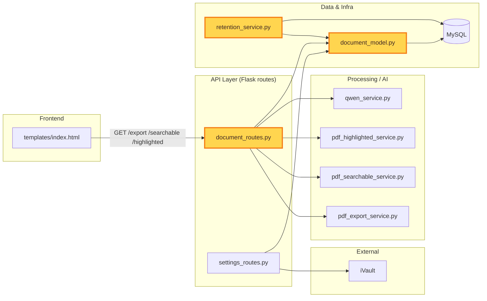

# iProfiler Daily Tasks — 2026-08-19

Pulled from the 'iProfiler Backlog' Notion database. All three High-priority items were already
cleared on 2026-08-17, and the full Medium-priority sweep (74 items) is already staged in
`2026-08-18-medium-priority.md`. Today's picks are the three highest-severity **non-security**
Performance/System-Bug/DB items remaining in the backlog — everything else open is either a
security-flavored item (XSS, tenant isolation, TLS, auth, credentials — left for a dedicated
security pass) or a lower-signal cleanup/accessibility task.

---

### Task 1: PDF export endpoints build entire PDF synchronously in memory on request thread

**Notion Reference:** https://app.notion.com/3bcb8d467eca8103b987d9fa71cba5dd

**Target File:** `document_routes.py`

**Issue Summary:**
`export_document_pdf` (~3021), `export_searchable_pdf` (~3045), and `export_highlighted_pdf`
(~3071) each call their generator synchronously (`generate_export_pdf` /
`generate_searchable_pdf` / `generate_highlighted_pdf`), hold the full `pdf_bytes` in memory,
and return it via `FlaskResponse(pdf_bytes, ...)` with no streaming, no timeout, and no size
guard. A large document blocks a worker thread for the full generation time and spikes memory
proportionally to PDF size.

**Step-by-step fix logic:**
1. Add a size/complexity guard before generation: read `doc_dict.get("page_count")` (or fall
   back to `len(doc_dict.get("raw_text") or "")`) and return `413` with a clear error if it
   exceeds a new `MAX_EXPORT_PAGES` / `MAX_EXPORT_CHARS` env-configurable threshold, before
   calling into `pdf_export_service` / `pdf_searchable_service` / `pdf_highlighted_service`.
2. Wrap each of the three generation calls with a hard timeout (e.g. run the generator in a
   `concurrent.futures.ThreadPoolExecutor` and `.result(timeout=...)`, or a watchdog thread)
   so a pathological document can't hang a worker indefinitely; return `504` on timeout instead
   of leaving the request hanging.
3. Replace the in-memory `FlaskResponse(pdf_bytes, ...)` construction with a streamed response:
   write the generator's output to a `tempfile.NamedTemporaryFile` and serve it via Flask's
   `send_file(..., conditional=True)`, or wrap the existing `io.BytesIO()` buffer in a generator
   passed to `Response(stream_with_context(...), ...)`, so the full PDF is never held as one
   in-memory `bytes` object on the response path.
4. Apply the same three changes consistently across `export_document_pdf`,
   `export_searchable_pdf`, and `export_highlighted_pdf` since all three share this exact shape
   — don't fix only one and leave the others inconsistent.
5. **Verify:** export a large multi-page test document (50+ pages) through all three endpoints,
   watch process RSS during the request (`psutil` or `docker stats`) to confirm memory no longer
   spikes proportional to full PDF size, and fire a concurrent lightweight request (e.g.
   `GET /api/documents/rag/stats`) during the export to confirm the worker isn't blocked.

---

### Task 2: Default retention policy never persisted to DB

**Notion Reference:** https://app.notion.com/3bcb8d467eca817eab28e19450095a1f

**Target File:** `retention_service.py`

**Issue Summary:**
`get_retention_policy()` (lines 23–31) constructs a default `TenantRetentionPolicy` in memory
when none exists for a tenant, but never calls `db.session.add()` / `commit()`. The default is
silently re-created identically on every call, never appears in an admin retention-policy
listing, and `policy.id` stays `None` forever.

**Step-by-step fix logic:**
1. In `get_retention_policy()` (lines 23–31), after constructing the default `policy` object
   when the query returns `None`, call `db.session.add(policy)` then `db.session.commit()`
   before returning it, so the first caller for a given tenant actually persists the row.
2. Guard the commit against a race where two concurrent requests both see no existing policy
   and both try to insert for the same `tenant_id`: wrap the commit in
   `try/except IntegrityError`, and on conflict `db.session.rollback()` and re-query
   `TenantRetentionPolicy.query.filter_by(tenant_id=tenant_id).first()` to return the row the
   other request just inserted (`tenant_id` is the primary key per `document_model.py` line 199,
   so a duplicate insert raises rather than silently succeeding).
3. Check callers that might implicitly rely on the old "unsaved, id is None" behavior —
   `_document_is_expired` (line 52) and any admin retention-policy listing route in
   `settings_routes.py` — to confirm none of them special-case a policy with no `id`.
4. **Verify:** call `get_retention_policy()` for a tenant with no existing row, then directly
   query `TenantRetentionPolicy.query.filter_by(tenant_id=...).first()` (or hit the admin
   retention-policy listing endpoint) and confirm the row now exists with a non-null `id`, and
   that calling it again for the same tenant doesn't create a second row.

---

### Task 3: No unique constraint on external_source/external_id for iVault types

**Notion Reference:** https://app.notion.com/3bcb8d467eca819da04bcaafbedeb5c7

**Target File:** `document_model.py`

**Issue Summary:**
`DocumentType.external_id` (line 17) is indexed but not unique, and there's no composite
unique constraint on `(external_source, external_id)`. The find-or-create iVault sync logic
does a query-then-insert with no DB-level guard, so two concurrent sync calls can both pass the
existence check and insert duplicate `DocumentType` rows for the same external class.

**Step-by-step fix logic:**
1. Add a composite unique constraint to the `DocumentType` model (lines 6–19) via
   `__table_args__ = (db.UniqueConstraint('external_source', 'external_id', name='uq_document_type_external'),)`.
2. Note that `db.create_all()` only creates missing tables and will not retroactively alter the
   already-deployed `document_types` table (the same caveat already called out in this file for
   `DocumentField`, ~line 59) — write an explicit `ALTER TABLE` / Flask-Migrate migration to add
   the constraint to existing databases, and first run a query to detect any pre-existing
   `(external_source, external_id)` duplicates that would violate it (resolve those manually
   before applying).
3. Update the find-or-create sync logic in `settings_routes.py`
   (`_sync_ivault_document_type_with_session` / `sync_ivault_all_document_types`) to catch
   `IntegrityError` on the insert path and fall back to re-querying by
   `(external_source, external_id)` instead of assuming its prior `SELECT` is still authoritative.
4. **Verify:** fire two concurrent sync calls (e.g. a small script issuing two threads/requests)
   for the same `external_id`, and confirm only one `DocumentType` row exists afterward — the
   second call should hit the handled `IntegrityError` path and return the existing row rather
   than creating a duplicate.

---

## System Process Mapping

Today's 3 tasks touch the API layer (PDF export routes) and the Data & Infra layer (retention
policy persistence, DocumentType schema integrity) — highlighted below in context of the
surrounding request/data flow.

**Legend:** highlighted nodes (`document_routes.py`, `retention_service.py`, `document_model.py`)
are today's 3 target modules — Task 1 (export streaming) lives in the API layer, Tasks 2 & 3
(retention persistence, schema constraint) live in Data & Infra.
