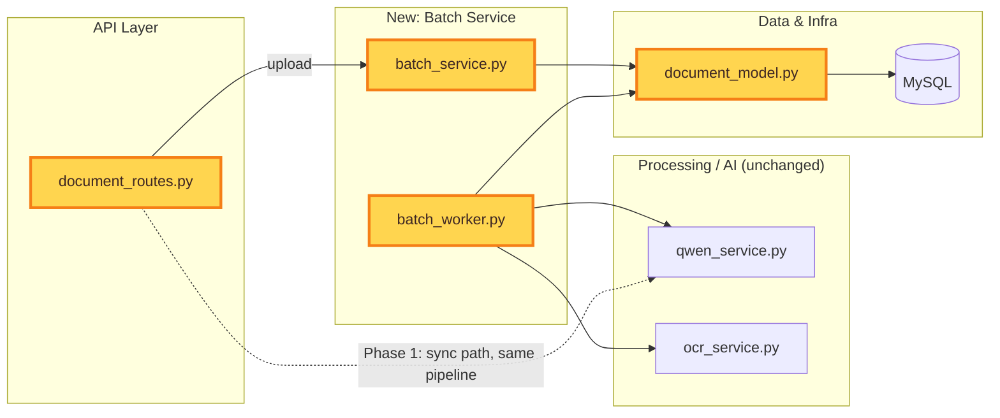

# iProfiler Batch Processing — Phase 1 Tasks — 2026-09-14

## ✅ STATUS: COMPLETE (2026-09-14)

All 4 tasks implemented, tested, and verified. See verification summary below.

**Commits:**
- `90c4354` - Task 1: Add Batch, SourceFile, DocumentJob models + migration
- `756ad35` - Task 2: Implement create_batch() and batch status management
- `7da5d7d` - Task 3: Migrate single-document upload to create_batch()
- `4433a00` - Task 4: Add batch processing worker with SKIP LOCKED
- `78d3b3c` - Fix Windows console encoding in test_batch_worker.py

**Verification Results:**
- ✅ All modules import successfully
- ✅ 8/8 unit tests pass (test_batch_service.py)
- ✅ Database schema verified (3 tables, composite index on document_jobs)
- ✅ Batch creation verified (3 files → 3 jobs, total_jobs=3)
- ✅ Worker claim verified (SKIP LOCKED prevents double-claims)
- ✅ Retry logic verified (exponential backoff, dead_letter after 3 attempts)
- ✅ Batch status rollup verified (open → processing → completed_with_errors)

---

## ORIGINAL TASK DESCRIPTION

Derived from this session's batch-processing architecture scoping (see project doc
`claude/2026-09-14-batch-processing-architecture.md` and the accompanying wireframe).
This is **Phase 1 of the 5-phase rollout: foundation only — no user-visible change.**
It introduces the `Batch` / `SourceFile` / `DocumentJob` data model and the extraction
worker, and migrates the existing single-document upload to flow through the new
pipeline as a batch of one. The split step (Phase 2), the bulk-upload UI (Phase 2),
the dashboard/notifications (Phase 3), and the barcode-decoder fix (Phase 4) are
**not** part of this task file — do not start them yet.

Unlike the daily `.tasks/` files, this one wasn't pulled from the Notion backlog —
it's a scoped feature build. Sync status back to Notion manually if you track it there.

---

### Task 1: Add `Batch`, `SourceFile`, `DocumentJob` models + migration

**Target File:** `document_model.py` (+ a new Flask-Migrate revision)

**Goal:**
Give batch and per-document state a durable home in MySQL instead of the in-memory
job dicts in `document_routes.py` that don't survive a restart or a second gunicorn
worker.

**Step-by-step implementation:**
1. Add a `Batch` model: `id` (PK), `client_id`, `source` (enum: `manual_upload` /
   `watched_folder` / `api`), `status` (enum: `draft` / `open` / `processing` /
   `completed` / `completed_with_errors`), `total_jobs`, `completed_count`,
   `failed_count`, `split_pending_count`, `notify_email`, `created_at`,
   `completed_at`. Match this file's existing conventions (see `DocumentType` /
   `TenantRetentionPolicy` for style — declarative `db.Column`, tenant scoping).
2. Add a `SourceFile` model: `id`, `batch_id` (FK), `file_path`, `page_count`,
   `split_mode` (enum: `none` / `mrn_barcode` / ...), `status` (enum: `queued` /
   `splitting` / `split_done` / `failed`).
3. Add a `DocumentJob` model: `id`, `batch_id` (FK), `source_file_id` (FK),
   `page_range`, `file_path`, `status` (enum: `queued` / `claimed` / `processing` /
   `succeeded` / `failed` / `dead_letter`), `attempts`, `max_attempts` (default 3),
   `last_error`, `claimed_by`, `claimed_at`, `priority` (default 0), `result_ref`,
   `created_at`, `started_at`, `finished_at`.
4. Add indexes: `DocumentJob(status, priority, created_at)` for the claim query;
   `Batch(status)`; FK indexes on `batch_id` / `source_file_id`.
5. Write the Flask-Migrate revision. This file already notes (near `DocumentField`)
   that `db.create_all()` won't alter existing tables — don't rely on it here either.
6. **Verify:** run the migration against a dev DB copy; confirm all three tables and
   indexes exist; confirm `flask db downgrade` cleanly reverses it.

---

### Task 2: Implement `create_batch()`

**Target File:** new `batch_service.py` (mirrors `retention_service.py`'s
file-per-concern pattern)

**Goal:**
The single internal entry point every intake path will eventually call —
`create_batch(files, source, client_id, split_mode)` — per the architecture doc §4.4.

**Step-by-step implementation:**
1. Create `batch_service.py`. `create_batch(files, source, client_id,
   split_mode="none", notify_email=None)` creates one `Batch` row and one
   `SourceFile` row per file in `files`.
2. For this phase only handle `split_mode="none"`: immediately create one
   `DocumentJob` per `SourceFile` covering the whole file (no split step yet — that's
   Phase 2). Set `Batch.total_jobs` accordingly.
3. Add `get_batch_status(batch_id)` returning the rollup fields, for reuse by the
   dashboard in a later phase.
4. **Verify:** unit test creating a batch with 3 files (`split_mode="none"`) — assert
   3 `DocumentJob` rows exist and `Batch.total_jobs == 3`.

---

### Task 3: Migrate single-document upload to `create_batch()`

**Target File:** `document_routes.py`

**Goal:**
Retire the current one-off upload path (the in-memory job-dict tracking flagged in
the architecture doc) without changing today's user-visible upload behavior.

**Step-by-step implementation:**
1. Find the existing single-document upload route (the one whose partial-failure
   handling was hardened in Task 34 of the 2026-08-18 fix batch — orphaned files on
   a failed upload).
2. Replace its direct processing call with `batch_service.create_batch(files=
   [uploaded_file], source="manual_upload", client_id=..., split_mode="none")`.
3. Keep the response shape identical — the frontend still expects today's
   single-document response. For this phase, process that one `DocumentJob`
   synchronously in the request (same OCR → Qwen pipeline as today, just reading and
   writing through the new row instead of the in-memory dict) rather than waiting on
   the async worker from Task 4.
4. Leave the existing in-memory job dicts in place but unused by this path — other
   code (iVault job tracking) may still depend on them; that's a separate cleanup,
   out of scope here.
5. **Verify:** upload one document through the existing UI; confirm the response and
   Document History entry are unchanged; then check MySQL directly and confirm
   exactly one `Batch` (size 1) and one `DocumentJob` (`status="succeeded"`) were
   created for it.

---

### Task 4: Extraction worker (claim loop)

**Target File:** new `batch_worker.py`

**Goal:**
The standalone worker process from architecture doc §4.2, using the same
`SKIP LOCKED` coordination pattern already proven in `retention_service.py`'s
distributed purge lock.

**Step-by-step implementation:**
1. Implement the claim loop:
   ```sql
   UPDATE DocumentJob
   SET status='claimed', claimed_by=:worker_id, claimed_at=NOW()
   WHERE id = (
     SELECT id FROM DocumentJob
     WHERE status='queued'
     ORDER BY priority DESC, created_at ASC
     LIMIT 1 FOR UPDATE SKIP LOCKED
   );
   ```
2. On claim, run the existing OCR → Qwen extraction pipeline against the claimed
   job's `file_path`. On success: mark `succeeded`, store `result_ref`, increment
   `Batch.completed_count`. On failure: increment `attempts`; requeue with backoff if
   under `max_attempts`, else mark `dead_letter` and increment `Batch.failed_count`.
3. Not wired into the deployment yet — this task just gets the worker correct and
   runnable standalone (`python batch_worker.py`), sharing its processing function
   with Task 3's synchronous path. Wiring it into systemd/Docker Compose is a
   Phase 1 follow-up once this is verified, not a blocker for this task.
4. **Verify:** manually insert a few `DocumentJob` rows in `queued` status (bypassing
   the synchronous path), run `batch_worker.py`, confirm it claims and processes them
   one at a time, and confirm two worker instances running concurrently never
   double-claim the same job (kill/restart test).

---

## System Process Mapping

Phase 1 touches the data layer (new tables), a new service layer, and the upload
route — the OCR/Qwen extraction pipeline itself is reused unchanged.



**Legend:** highlighted nodes (`document_model.py`, `batch_service.py`,
`document_routes.py`, `batch_worker.py`) are this phase's targets.
`qwen_service.py` / `ocr_service.py` are called by both the Phase 1 synchronous path
and the new worker, unmodified.
