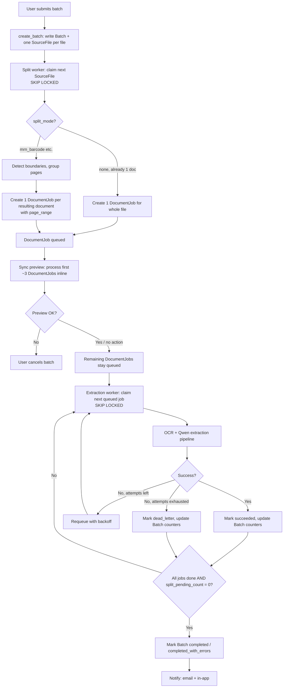

# iProfiler — Batch Processing Architecture (Scoping Session)

**Date:** 2026-09-14
**Type:** Architecture scoping / decision record
**Status:** Draft — ready for engineering review

---

## 1. Problem Statement

The current upload/process pipeline is one-to-one (or one-to-a-handful) and synchronous: a document is uploaded, processed on a background thread inside the Flask request lifecycle, and progress is streamed live to the browser over SSE. This is the right shape for a demo or very low daily volume. It is the wrong shape for a real client scanning or uploading 10,000+ pages a day — at that volume the current design has three structural failure points:

1. **Job state lives in memory, per process.** Upload/iVault job dicts are tracked in-process and TTL-swept. Under a multi-worker gunicorn deployment, a batch's state is invisible to every worker except the one that received the request, and is lost entirely on restart or deploy.
2. **No queue in front of a capacity-limited backend.** The extraction backend (Qwen vision model via LM Studio/Ollama) runs on a single, effectively single-threaded GPU box. Firing many concurrent threads at it doesn't parallelize work — it either queues invisibly at the model or destabilizes the box.
3. **Per-document SSE doesn't scale to "watch 10,000 things happen."** The UX pattern needs to become batch-level status, not per-file streaming.

This document proposes an architecture to address all three, informed by a scoping conversation covering scale targets, backend constraints, desired UX, and infrastructure appetite.

---

## 2. Baseline: Current Architecture

Source: `2026-08-19-before-after-impact-analysis.md` and `2026-08-18-system-benefit-impact-analysis.md`.

- **Web layer:** Flask, deployed via `waitress-serve` / gunicorn (multi-worker) in Docker.
- **Extraction:** `qwen_service.py` calls a self-hosted Qwen vision model through LM Studio/Ollama. All call sites now route through a shared `_call_qwen_with_retry` wrapper (3 attempts, exponential backoff on transient errors: connection/timeout/5xx/rate-limit).
- **OCR:** Tesseract (portable via `TESSERACT_CMD` env var) and `ocrmypdf`; OCR failures now raise `OCRError` rather than masquerading as extracted text.
- **Job tracking:** In-memory dicts in `document_routes.py` (upload jobs, iVault jobs), TTL-swept.
- **Progress reporting:** SSE streams per upload / per iVault-recognition run, now with bounded timeouts and reconnect handling.
- **Concurrency safety already in place:** `learned_structures.json` reads/writes are lock-protected with atomic temp-file-then-`os.replace`; the retention purge uses a MySQL distributed lock so multiple gunicorn workers can't double-run it. This is a directly reusable idiom for batch worker coordination.
- **Data store:** MySQL.

---

## 3. Constraints Established This Session

| Question | Answer | Implication |
|---|---|---|
| Target scale | Undefined — "just want headroom" | Design for a clean scale-up path, don't over-build now |
| Extraction backend concurrency | Single GPU box, effectively single-threaded | Real bottleneck is the model, not Flask; batching ≠ speed, it means durability/tracking/retry |
| Desired batch UX | Hybrid: synchronous preview on first few docs, rest async | See §4.3 |
| Infra appetite | Unsure, but wants room to grow | Start on existing MySQL, architect for a later swap to a real broker |
| Batch intake source | Flexible / undecided | Build one internal entry point; UI upload is the first caller |
| Coexistence with current one-by-one flow | Recommendation requested | Unify — every upload becomes a "batch," even of size 1 |
| Does batch input need the merge/split (MRN-barcode) fan-out step, per the AI Rec demo spec? | Both — some clients upload pre-separated files, others upload merged multi-page scans | Total document count in a batch isn't always known at ingestion time; a split stage must run ahead of the per-document extraction queue (§4.1a) |

---

## 4. Proposed Architecture

### 4.1 Data Model

**`Batch`**

| Column | Notes |
|---|---|
| `id` | PK |
| `client_id` | for future multi-tenant fairness |
| `source` | `manual_upload` \| `watched_folder` \| `api` (extensible) |
| `status` | `queued` \| `processing` \| `completed` \| `completed_with_errors` |
| `total_jobs`, `completed_count`, `failed_count` | rollup counters — see §4.1a on why `total_jobs` may be provisional |
| `split_pending_count` | number of `SourceFile`s not yet split into `DocumentJob`s; batch isn't "fully known" until this hits 0 |
| `notify_email` | nullable |
| `created_at`, `completed_at` | |

**`SourceFile`** (new — the raw uploaded artifact, before it's known how many logical documents it contains)

| Column | Notes |
|---|---|
| `id` | PK |
| `batch_id` | FK → `Batch` |
| `file_path`, `page_count` | |
| `split_mode` | `none` (already one document) \| `mrn_barcode` \| other existing modes from the current split-PDF service |
| `status` | `queued` \| `splitting` \| `split_done` \| `failed` |

**`DocumentJob`**

| Column | Notes |
|---|---|
| `id` | PK |
| `batch_id` | FK → `Batch` |
| `source_file_id` | FK → `SourceFile` — provenance back to the original upload |
| `page_range` | e.g. `"3-4"` — which pages of the source file this logical document covers, for traceability |
| `file_path` | the (possibly split-out) file this job processes |
| `status` | `queued` \| `claimed` \| `processing` \| `succeeded` \| `failed` \| `dead_letter` |
| `attempts`, `max_attempts` (default 3) | |
| `last_error` | for dead-letter visibility |
| `claimed_by`, `claimed_at` | worker identity/time, for stuck-job detection |
| `priority` | reserved, default 0, unused in V1 |
| `result_ref` | pointer to extracted data |
| `created_at`, `started_at`, `finished_at` | |

### 4.1a Split / Fan-Out Stage

This session confirmed batches can arrive either way: some clients upload already-separate files (one document per file — go straight to `DocumentJob`), others upload merged multi-page scans that need the same split logic as the AI Rec demo (MRN-barcode-triggered document boundaries, per `iprofiler-ai-rec-spec.md` in `Claude outputs/`). That means **the total number of documents in a batch is not always knowable at ingestion** — it depends on how many barcode-triggered boundaries the split step finds inside each source file.

So ingestion creates one `SourceFile` row per uploaded file, not directly a `DocumentJob`. A lightweight split worker (reusing the existing split-PDF service and its `mrn_barcode` split mode, already implemented per the AI Rec work) claims `SourceFile`s the same `SKIP LOCKED` way as §4.2, and for each one either: (a) if `split_mode = none`, creates exactly one `DocumentJob` covering the whole file, or (b) if `split_mode = mrn_barcode` (or another mode), runs the split, and creates one `DocumentJob` per resulting document with its `page_range` recorded — mirroring the demo's 6-page-PDF-in / 5-documents-out example. Each new `DocumentJob` increments `Batch.total_jobs`; finishing a `SourceFile` decrements `split_pending_count`.

Two things worth flagging from the AI Rec spec's known-issues list (item 12) because they directly affect batch reliability at volume, not just the demo: barcode/QR fields are currently read via AI/OCR-style understanding rather than a true decoder, which is why values have occasionally been hallucinated from nearby visual clutter (items 3 and 7) instead of coming back empty or correct. At demo volume a wrong split is a one-off to notice and fix by hand; at 10,000-pages-a-day volume the same failure mode means documents silently merge into the wrong logical record or split incorrectly with no human watching every one. **The proposed fix in that same doc — a real barcode/QR field type backed by an actual decoder (pyzbar/ZXing/OpenCV), falling back to AI/OCR only when no valid pattern decodes — becomes a prerequisite for trusting the split step at batch scale**, not just a nice-to-have. I'd treat it as a dependency of this batching work, not a separate backlog item.

### 4.2 Worker Lifecycle

A small number of long-running worker processes (start with exactly 1, matched to the GPU's real throughput — see §6) run independently of the gunicorn web workers. Claim loop, using MySQL 8's `SKIP LOCKED` (the same coordination pattern already proven in `retention_service.py`'s distributed lock):

```sql
UPDATE DocumentJob
SET status='claimed', claimed_by=:worker_id, claimed_at=NOW()
WHERE id = (
  SELECT id FROM DocumentJob
  WHERE status='queued'
  ORDER BY priority DESC, created_at ASC
  LIMIT 1 FOR UPDATE SKIP LOCKED
);
```

The worker then runs the existing OCR → Qwen extraction → field-mapping pipeline unchanged. On success: mark `succeeded`, store `result_ref`, increment `Batch.completed_count`. On failure: increment `attempts`; if under `max_attempts`, return to `queued` with backoff; otherwise mark `dead_letter`, increment `Batch.failed_count`, and keep the error visible for manual retry from the UI. When `completed_count + failed_count == total_jobs` **and** `split_pending_count == 0` (so a batch can't falsely report "done" while a source file is still mid-split), the batch is marked `completed` or `completed_with_errors` and a notification fires.

A second, separate claim loop (same `SKIP LOCKED` pattern, different table) runs the split stage from §4.1a against `SourceFile` rows, ahead of the `DocumentJob` queue. It's a distinct worker because it's a different, generally lighter-weight operation (barcode/QR decode + page grouping, not a full vision-model call) and shouldn't compete with extraction jobs for GPU time.

### 4.3 Hybrid Batch UX

1. **Ingest (sync, fast):** validate files, create one `Batch` row and one `SourceFile` row per uploaded file, all `queued`. Seconds, not minutes — no OCR or model calls yet.
2. **Instant preview (sync, thin slice):** synchronously split the *first* `SourceFile` (if it needs splitting) and run the first ~3 resulting `DocumentJob`s through the full extraction pipeline, returning real results to the user — actual extracted fields, not a placeholder. For pre-separated-file clients this is trivial (no split, straight to extraction); for merged-scan clients this is where the split step itself gets its first trust check too — a wrong split (see the barcode-decoder caveat in §4.1a) is exactly the kind of thing this preview step exists to catch. If the document type, split boundaries, or OCR are obviously wrong, the user cancels here instead of two hours later.
3. **Background grind (async):** the remaining `SourceFile`s are split (fanning out into more `DocumentJob`s as they complete) and the growing pool of `DocumentJob`s is worked off by the extraction worker loop, at whatever pace the GPU sustains.
4. **Batch dashboard:** a rollup view — "3 previewed · 212/500+ processed · 4 failed" (the "+" while `split_pending_count > 0`, since total isn't final yet) — updated via a light poll or a single SSE/status channel keyed by `batch_id` (not one stream per document).
5. **Completion:** notify (email + in-app, per defaults below); failed jobs are individually visible and re-runnable without rerunning the whole batch.

### 4.4 Unified Intake

One internal entry point: `create_batch(files, source, client_id, split_mode) → Batch + SourceFiles`. Manual bulk upload in the UI is the first caller. A watched-folder poller or an external API submission are future callers of the *same* function — new producers, not new pipelines. Single-document upload also calls this with N=1 and `split_mode=none`, retiring the current bespoke one-off code path so there is exactly one processing pipeline to maintain going forward (directly avoids repeating bugs like Task 34's orphaned-files-on-partial-failure, which came from ad hoc job tracking). `split_mode` can be a per-batch choice in the UI (pre-separated vs. merged scan) or auto-detected per file (e.g. page count > 1 defaults to attempting a split) — worth deciding with actual client upload samples rather than guessing.

### 4.5 Infrastructure Footprint (V1)

No new broker. The claim-queue above runs on the existing MySQL instance — durability and multi-worker-safe coordination without operating Redis/RabbitMQ/Celery for a backend whose real concurrency ceiling is ~1 anyway. The worker/queue interface (claim next job → process → mark result) is written narrowly enough that swapping the MySQL-polling queue for Redis+RQ or Celery later — when a second GPU box or a cloud vision API removes the concurrency ceiling — is a backend swap behind that interface, not a redesign. That's the "headroom" without premature operational cost.

### 4.6 Defaults Locked This Session (revisit later)

- **Retry:** automatic, up to 3 attempts with backoff, reusing the transient-error classification already established in `qwen_service.py`; then dead-letter with a visible, manually-retriable error.
- **Notification:** email + in-app on batch completion.
- **Fairness:** single global FIFO queue; `priority` column present but unused until multi-tenant contention is a real, observed problem.

---

## 5. Rollout Phasing

- **Phase 1 (foundation, no user-visible change):** add `Batch`/`SourceFile`/`DocumentJob` tables and the extraction worker process; migrate single-document upload to create a batch of 1 (`split_mode=none`) through the new pipeline.
- **Phase 2:** split worker (§4.1a) reusing the existing `mrn_barcode` split-PDF service; bulk upload UI + hybrid preview flow.
- **Phase 3:** batch dashboard, notifications, dead-letter retry UI.
- **Phase 4 (should land before real client volume, not after):** swap the AI/OCR-based barcode reading for a true decoder (pyzbar/ZXing/OpenCV) per the AI Rec spec's item 12 recommendation — batching makes this a reliability prerequisite, not a polish item.
- **Phase 5 (future, triggered by real need):** swap the DB-polling queue for Redis+RQ/Celery if GPU capacity grows; activate `priority` if concurrent multi-client contention becomes real.

---

## 6. Open Items / Follow-Ups

- **Load-test the LM Studio/Ollama backend** to find its actual sustainable concurrency before fixing worker count — everything above assumes "effectively 1," which should be confirmed, not assumed.
- **Confirm split_mode selection UX** — per-batch user choice vs. auto-detection per source file (§4.4) — needs real client upload samples to decide well.
- **File storage strategy** for large batches (local disk vs. object storage) — not yet discussed, matters once volume is real.
- **Retention/cleanup** for completed batch artifacts — should tie into the existing `retention_service.py` purge mechanism rather than a separate policy.
- **Notification channel preferences** — confirm email + in-app is sufficient, or whether a webhook is needed for API-submitted batches.

---

*Mermaid: proposed flow*


